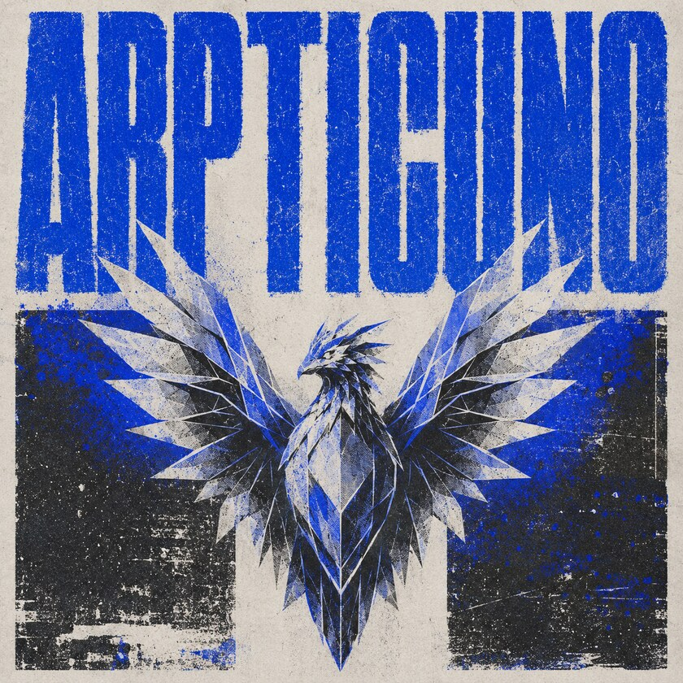

<p align="center">
  
</p>

Arpticuno is a small Windows Python CLI for resolving IPv4 neighbors on RFC1918 private or link-local networks and reporting selected TCP connectivity results.

> Use Arpticuno only on systems and networks you own or have explicit permission to test.

## Install

Requires Git, Windows and Python 3.10+. There are no third-party runtime dependencies; installation may download setuptools to build the package.

```powershell
git clone https://github.com/delriscotechnologies/arpticuno.git
cd arpticuno
py -3 -m venv .venv
.\.venv\Scripts\python.exe -m pip install .
.\.venv\Scripts\arpticuno.exe --help
```

These commands run from the repository root without activating the environment. Replace `192.168.1.0/24` with your authorized local subnet:

```powershell
.\.venv\Scripts\arpticuno.exe scan 192.168.1.0/24 --ports 22,80,443
```

## What it does

Arpticuno:

1. Validates RFC1918 private or IPv4 link-local targets.
2. Resolves IPv4-to-MAC mappings with the Windows IP Helper API.
3. Checks selected TCP ports with normal socket connections.
4. Produces table, JSON, or CSV output.

Windows may satisfy a resolution from its local ARP table; otherwise `SendARP` sends an ARP request. `--iface` uses the supplied local IPv4 address as the source for both ARP resolution and TCP connections. TCP sockets bind that source address; Windows routing still selects the outbound route. `--retries` retries only unsuccessful resolutions.

The default TCP selection is ports `1-7000`. With `--fail-on-inconclusive`, the command returns exit code `3` when every TCP probe fails.

Output defaults to a table. Use `--format json` or `--format csv` and optionally `--output report.json` or `--output report.csv`; the output parent directory must exist. Existing regular output files are replaced. JSON reports use `schema_version: 2.0`.

## Offline preview

The synthetic preview sends no network traffic:

```powershell
.\.venv\Scripts\python.exe -m arpticuno.sandbox --no-banner
```

Its synthetic summary is:

```text
Results: Target(s): 192.168.1.0/24 | Resolved hosts: 3 | TCP probes: 21000 | Open TCP ports: 5
Status: completed
```

## Scope and limits

Arpticuno is restricted to Windows, RFC1918 private or IPv4 link-local targets, and TCP connect scanning. Physical addresses can only be resolved for destinations on the local subnet.

| Limit | Maximum |
| --- | ---: |
| Comma-separated target entries | 256 |
| Distinct target addresses | 65,536 |
| Worst-case `SendARP` calls | 65,536 |
| Resolution retries | 5 |
| Resolved hosts | 256 |
| TCP ports per host | 65,535 |
| Concurrent TCP workers | 512 |
| TCP connect timeout | 10 seconds |
| Total TCP probes | 1,000,000 |

TCP timeout, worker count, ports, and source-address syntax are checked before discovery. The TCP probe budget depends on the resolved host count and is checked after discovery, before TCP connections. With the default 7,000 ports, that budget permits at most 142 resolved hosts per scan.

The `SendARP` call limit is calculated as `target addresses × (retries + 1)`. Successful resolutions stop retrying.

Resolve time measures the duration of the Windows resolution call and may represent a cached ARP-table lookup rather than network round-trip time.

Exit codes: `0` for a completed command (including no resolved hosts or no open ports), `1` for an operational error, `2` for invalid arguments, and `3` for wholly inconclusive TCP probes when `--fail-on-inconclusive` is selected. Closed ports are conclusive TCP results.

See [SECURITY.md](SECURITY.md) for security notes.

## License

Arpticuno is released under the [MIT License](LICENSE).
